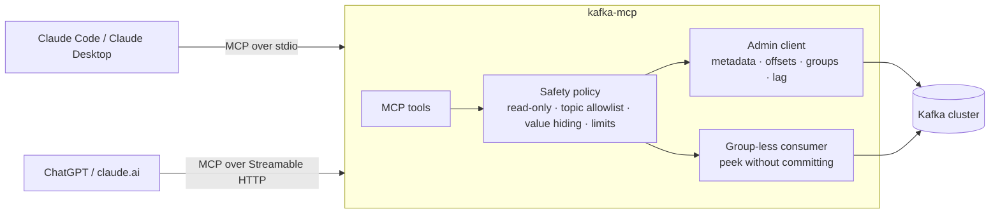

# kafka-mcp

[](https://github.com/mauricioacevedo/kafka-mcp/actions/workflows/ci.yml)
[](https://pkg.go.dev/github.com/mauricioacevedo/kafka-mcp)
[](LICENSE)

An [MCP](https://modelcontextprotocol.io) server that lets AI assistants **inspect Kafka clusters**: topics,
consumer groups, lag and messages. Works with Claude (Claude Code, Claude Desktop, claude.ai), ChatGPT, and any
other MCP client.

Ask in plain language instead of chaining `kafka-consumer-groups.sh` commands:

> *"Is any consumer falling behind?"*
> *"Why is fraud-detector lagging, and what are the messages it hasn't processed?"*
> *"Show me the last 5 orders for customer cus-42."*
> *"Is the payments topic under-replicated?"*

## How it works



- **Lag with a diagnosis.** kafka-mcp doesn't stop at offsets. It explains what they mean: *stopped consumers*,
  *lag concentrated on one partition (hot key or stuck consumer)*, *lagging partitions with no assigned member*,
  *rebalancing*, and so on. That gives the model something concrete to reason about.
- **Peeking never affects consumers.** Messages are read with a short-lived client that does not join a consumer
  group, so it never commits offsets or triggers rebalances.
- **Readable messages.** JSON is decoded, text is returned as is, binary data is base64 encoded, tombstones are
  marked, and long values are truncated safely without splitting UTF-8 characters.
- Built on [franz-go](https://github.com/twmb/franz-go) and the official
  [MCP Go SDK](https://github.com/modelcontextprotocol/go-sdk).

## Tools

| Tool | What it does | Read-only |
|---|---|---|
| `describe_cluster` | Cluster ID, controller, brokers, topic count | ✅ |
| `list_topics` | Partitions, replication factor, approximate message count; filter by name | ✅ |
| `describe_topic` | Per-partition leader/replicas/ISR/offsets, under-replication, configs that differ from the defaults | ✅ |
| `list_consumer_groups` | Groups and their state | ✅ |
| `describe_consumer_group` | Members and assignments, committed offset and lag per partition, diagnosis | ✅ |
| `find_lagging_groups` | Every group at or above `min_lag`, most behind first, with a diagnosis | ✅ |
| `peek_messages` | Latest, earliest, from an offset or from a timestamp; one or all partitions | ✅ |
| `produce_message` | Write one message (needs `--allow-produce`) | ❌ |

## Safety by default

- **Read-only unless enabled.** `produce_message` refuses to run until you pass `--allow-produce`.
- **Topic allowlist for message contents.** Use `--allow-topics "orders.*,payments"` to choose which topics' messages
  can be read or written. Metadata and lag stay visible for every topic. Internal topics (`__consumer_offsets`, …)
  are only accessible if you allow them explicitly.
- **`--hide-values` for sensitive data.** Peek returns keys, headers, sizes and timestamps but never message values.
  Useful when topics carry personal data.
- **Limits:** maximum messages per peek (`--max-messages`, hard cap 500), value truncation (`--max-value-bytes`),
  and a timeout per operation.
- **Credentials only from the environment.** The SASL username and password are read from `KAFKA_SASL_USERNAME`
  and `KAFKA_SASL_PASSWORD`, never from flags, so they don't show up in process lists or client config files.
  Sensitive topic configs are shown as `[redacted]`.
- **The HTTP transport can require a bearer token** (`--http-token`). It listens on `127.0.0.1` by default.

## Quick start

### 1. Install

```bash
go install github.com/mauricioacevedo/kafka-mcp/cmd/kafka-mcp@latest
```

### 2. Start a demo cluster (optional)

```bash
docker compose up --build
```

This starts a single-node Kafka (KRaft mode), a traffic generator and kafka-mcp. The generator creates topics
`orders` and `payments` and three consumer groups worth investigating:

| Group | Behaviour |
|---|---|
| `shipping-service` | Healthy: keeps up with `orders` |
| `billing-service` | Too slow: falls further behind on `payments` every second |
| `fraud-detector` | Consumes for 20 seconds, then "crashes", leaving an Empty group whose lag grows |

Kafka is reachable from your machine at `localhost:29092`, and kafka-mcp at `http://localhost:8080/mcp`
(bearer token `demo-token`).

### 3. Connect your AI assistant

<details open>
<summary><b>Claude Code</b></summary>

```bash
claude mcp add kafka -- kafka-mcp --brokers localhost:29092
```
</details>

<details>
<summary><b>Claude Desktop</b></summary>

```json
{
  "mcpServers": {
    "kafka": {
      "command": "kafka-mcp",
      "args": ["--brokers", "localhost:29092"]
    }
  }
}
```

For a secured cluster, add `"--sasl-mechanism", "SCRAM-SHA-512", "--tls"` to `args`, and put the credentials in an
`"env"` block (`KAFKA_SASL_USERNAME` and `KAFKA_SASL_PASSWORD`).
</details>

<details>
<summary><b>ChatGPT, claude.ai and other remote clients</b></summary>

```bash
kafka-mcp --transport http --listen 127.0.0.1:8080 --brokers localhost:29092 \
  --http-token "$(openssl rand -hex 16)"
```

The MCP endpoint is `http://127.0.0.1:8080/mcp`. Hosted clients like ChatGPT and claude.ai need to reach it over
**HTTPS**, so expose it through a tunnel or reverse proxy you control, then add it as a custom connector in the
client's settings.
</details>

## Example session

Against the demo cluster (the first answer uses real output from a demo run):

```text
You:    Is anything falling behind?
Claude: → find_lagging_groups
        Three groups have lag:
        • fraud-detector: 96 messages behind on orders with no active consumers. Its consumers
          are stopped or crashing, so it won't recover on its own.
        • billing-service: 63 behind on payments with 1 active member.
        • shipping-service: 19 behind on orders with 1 active member.

You:    Check again. Are billing and shipping getting worse?
Claude: → find_lagging_groups
        billing-service has grown since the last check: its single consumer can't keep up.
        payments has 3 partitions, so you can run up to 3 members. shipping-service is still
        about the same, which is normal delay between commits.

You:    What has fraud-detector missed?
Claude: → describe_consumer_group fraud-detector
        → peek_messages orders (from: offset, per partition)
        ...
```

## Configuration

| Flag | Env | Default | Description |
|---|---|---|---|
| `--brokers` | `KAFKA_BROKERS` | `localhost:9092` | Comma-separated seed brokers |
| `--sasl-mechanism` | `KAFKA_SASL_MECHANISM` | | `PLAIN`, `SCRAM-SHA-256` or `SCRAM-SHA-512` |
| | `KAFKA_SASL_USERNAME`, `KAFKA_SASL_PASSWORD` | | SASL credentials (environment only) |
| `--tls` | | `false` | Connect with TLS |
| `--tls-ca` | | | PEM CA bundle (system roots by default) |
| `--tls-skip-verify` | | `false` | Skip certificate verification (development only) |
| `--allow-topics` | | all non-internal | Comma-separated [`path.Match`](https://pkg.go.dev/path#Match) patterns for topics whose messages may be read or written |
| `--allow-produce` | | `false` | Enable `produce_message` |
| `--hide-values` | | `false` | Never return message values |
| `--max-messages` | | `50` | Maximum messages per peek (hard cap 500) |
| `--max-value-bytes` | | `4096` | Truncate keys and values longer than this |
| `--timeout` | | `15s` | Timeout per operation |
| `--transport` | | `stdio` | `stdio` or `http` |
| `--listen` | | `127.0.0.1:8080` | HTTP listen address |
| `--http-token` | `KAFKA_MCP_HTTP_TOKEN` | | Bearer token required by the HTTP transport |

## Development

```bash
make test    # unit + integration tests with the race detector
make lint    # golangci-lint
make demo    # docker compose up --build
```

The integration tests run against [kfake](https://pkg.go.dev/github.com/twmb/franz-go/pkg/kfake), an in-process Kafka
implementation, so `go test ./...` needs neither Docker nor a running broker. They cover real consumer groups,
committed offsets, every peek mode and the MCP tools end to end.

```text
cmd/kafka-mcp         CLI: flags, stdio/HTTP transports, bearer auth
cmd/demo-producer     demo traffic generator with healthy, slow and stopped consumers
internal/inspector    cluster/topic/group/lag logic, diagnosis, peek and produce, safety policy
internal/mcpserver    MCP tool definitions
```

## License

[MIT](LICENSE)
